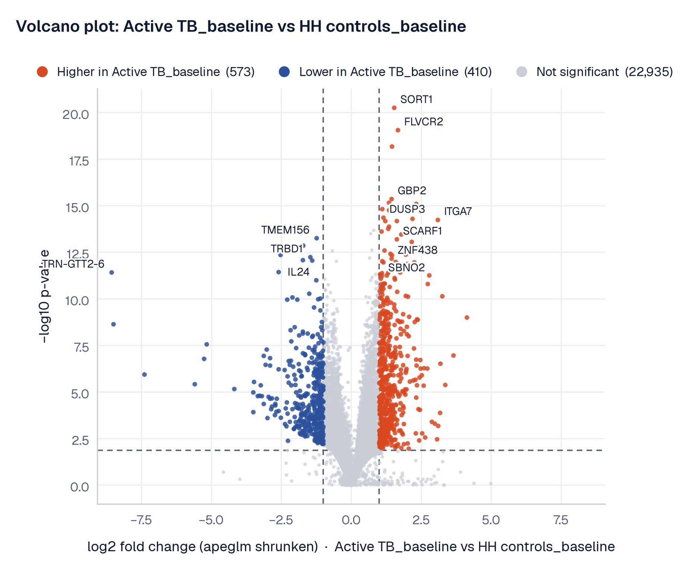
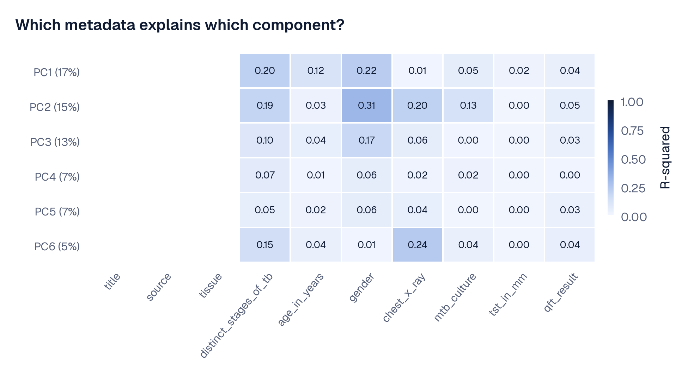
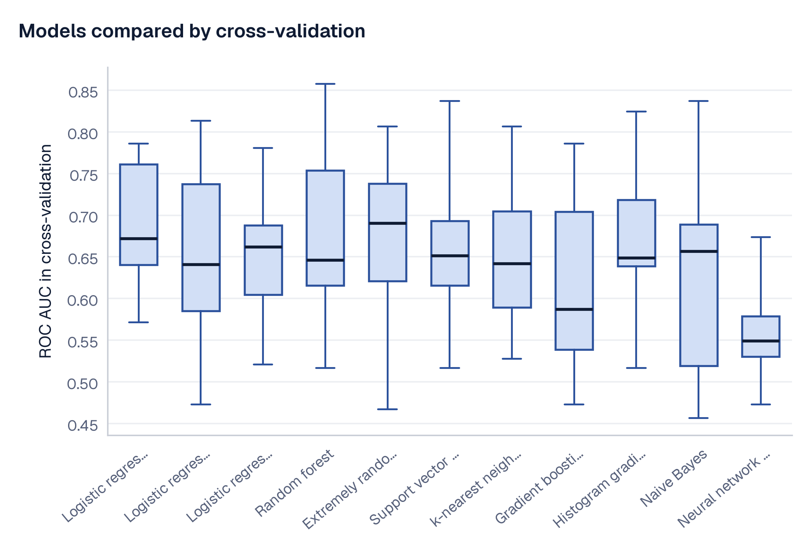
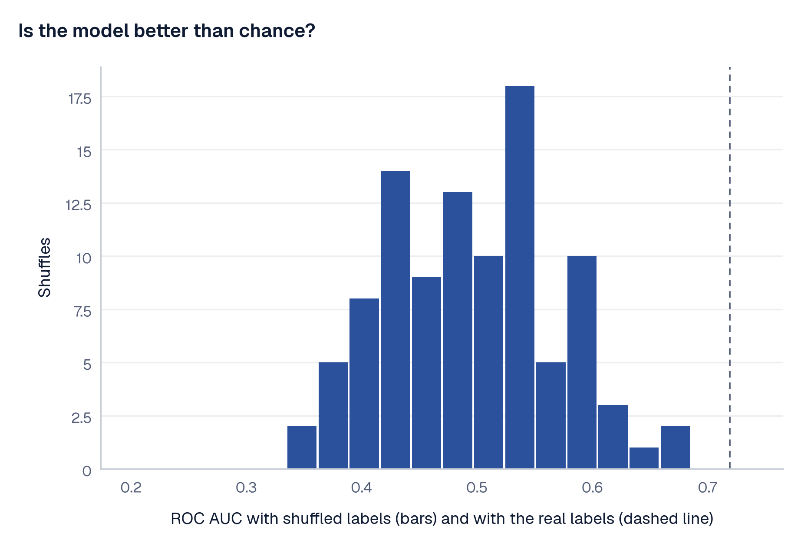
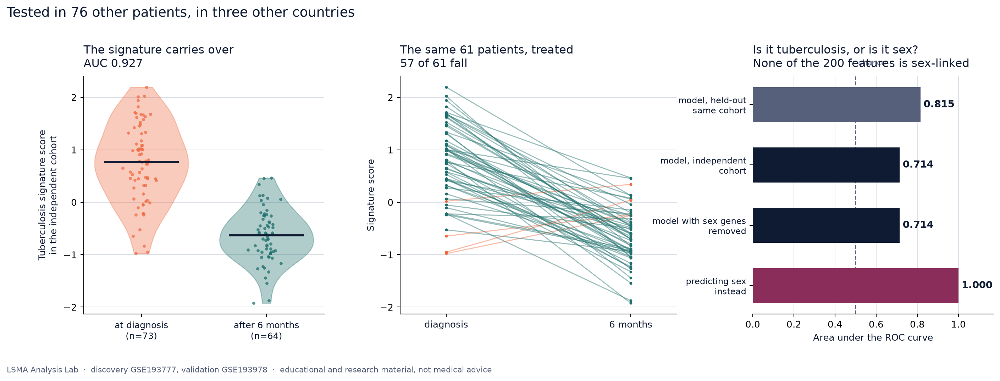

# Tuberculosis, written in the blood: what replicates, what does not, and what the ranking table hides

Two worked analyses, run end to end in the **LSMA Analysis Lab** on public data, around one question:
**can a blood sample tell you that someone has tuberculosis?**

Chapter 1 asks it with differential expression. Chapter 2 asks it with machine learning, comparing eleven
model families on the same samples. Then a third section does the thing the lab explicitly says it cannot do
for you — it takes both answers to **76 other patients, in three other countries**, and sees whether they hold.

**Two findings worth the repository.** The first is that the gene signature **replicates strongly**: in an
entirely separate study it separates active disease from the same patients after six months of treatment at
AUC 0.927, and the score falls in 57 of 61 patients who were treated. That is a real, externally confirmed
result, and the series does not often get to report one.

The second is that the eleven-model comparison table is **almost entirely noise**. The best model scores 0.691
and the tenth scores 0.619, and the spread between folds is wider than the gap between them. The lab says so
itself, in the run: *"Picking the top of a table like this is usually picking noise."*

---

## Contents

| Chapter | Question | Lab module | Data |
|---|---|---|---|
| [1. RNA-seq](01-rna-seq/) | Which genes change in active tuberculosis? | `bulk-rnaseq` | GSE193777, 144 blood samples |
| [2. Machine learning](02-machine-learning/) | Can eleven models predict who is culture-positive? | `machine-learning` | GSE193777, 137 samples |
| [Validation](validation/) | Does any of it hold in other patients? | outside the lab | GSE193978, 273 samples, 76 patients |

Each chapter folder holds the lab's own report (`report/lab-report.pdf` and `.html`), the figures it drew, the
result tables, and `report/run.json` — every parameter, software version and stage summary.

---

## Introduction

Tuberculosis is diagnosed by finding the bacterium: sputum culture, which takes weeks, or molecular tests on
sputum, which many patients — children especially — cannot produce. A blood test that recognised active disease
from the host's own gene expression would be genuinely useful, and the search for one has produced a long
succession of published signatures.

That makes it a good subject for this series, because the field has a known failure mode. Blood signatures are
usually found in one cohort and reported with a cross-validation number, and the number is usually good. What
separates a useful signature from a statistical artefact is whether it survives being carried to patients it has
never seen — different country, different laboratory, different reason for sampling.

So this project is built to be carried. The discovery cohort is a prospective study of household contacts of
tuberculosis patients in southern India: people who were exposed, followed over time, and who span the whole
range from healthy contact to incipient disease to active tuberculosis. The validation cohort is a different
study entirely — patients in Indonesia, South Africa and Romania, sampled at diagnosis and again through six
months of treatment.

**This is educational and research material, not medical advice.** Nothing here is a diagnostic test, and nothing
here describes how any patient should be investigated or treated.

---

## Chapter 1 — RNA-seq: 6,248 genes, and a first component that is about sex

**Method.** 144 whole-blood samples, 39,376 genes, NCBI's uniformly recomputed counts. Low-expression genes
removed with `filterByExpr` grouped by disease stage, VST for exploration, then DESeq2 (negative binomial GLM,
Wald test, apeglm shrinkage) comparing **active tuberculosis at baseline (11 samples)** with **household contact
controls (39 samples)**, restricted to those two groups.

**Result.** 23,918 genes survived filtering, and **6,248 of them were significant** at adjusted *p* < 0.05 —
about a quarter of the measured transcriptome. Requiring a twofold change as well leaves **573 up** and
**410 down**. Enrichment found 389 over-represented sets and 2,085 by GSEA.

A quarter of the transcriptome moving is not, by itself, implausible for active tuberculosis: it is a systemic
infection and the blood interferon response to it is large and well described. But it is also what a comparison
of 11 against 39 looks like when something other than the disease differs between the groups, and the chapter
cannot tell those apart from the inside.

**What the lab's own diagnostics did to it.** Three warnings, all raised by the run itself:

- **The first principal component is best explained by sex, not disease.** PC1 carries 17% of the variance, and
  the metadata column that explains it best is `gender` (*R*² = 0.22). The disease stage does not lead on either
  of the first two components. That is the sort of thing that makes a reader of the volcano plot uneasy, and it
  is tested directly in the validation section.
- **18 of 144 samples were flagged** on correlation and depth, with the lowest pairwise correlation at 0.75.
  They were left in; the lab asks you to look at them rather than deciding for you.
- **Library sizes span 5.6-fold** after normalisation factors are computed. Depth is corrected, but the shallow
  samples carry less information than the deep ones regardless.

**And a metadata problem worth naming.** `gender` is missing for 46 of 144 samples, and the culture result column
contains a value spelled `Poistive` — one patient, one typo, and that patient is silently dropped from any
analysis that asks for `Positive`.

---

## Chapter 2 — Machine learning: eleven models, and ten of them are the same model

**Method.** The question is changed slightly to get a usable number of cases: predict **culture-positive**
(48 samples) against **culture-negative** (89), from 16,404 expressed genes. A quarter of the samples are held
out at the start; the remaining 102 are used for 5-fold cross-validation repeated twice, with the 200 best
features chosen **inside every fold** and settings tuned by a nested inner loop. Eleven model families compete.

**Result.** Here is the table, which is the point of the chapter:

| Model | Mean AUC | SD | Lowest fold | Highest fold |
|---|---|---|---|---|
| **Logistic regression (L2)** | **0.691** | 0.070 | 0.571 | 0.786 |
| Extremely randomised trees | 0.670 | 0.101 | 0.467 | 0.806 |
| Random forest | 0.670 | 0.108 | 0.517 | 0.857 |
| Support vector machine (linear) | 0.665 | 0.086 | 0.517 | 0.837 |
| Histogram gradient boosting | 0.659 | 0.092 | 0.517 | 0.824 |
| Logistic regression (lasso) | 0.653 | 0.098 | 0.473 | 0.813 |
| Logistic regression (elastic net) | 0.650 | 0.082 | 0.520 | 0.780 |
| k-nearest neighbours | 0.646 | 0.085 | 0.528 | 0.806 |
| Naive Bayes | 0.625 | 0.115 | 0.456 | 0.837 |
| Gradient boosting | 0.619 | 0.103 | 0.473 | 0.786 |
| Neural network (one hidden layer) | 0.565 | 0.058 | 0.473 | 0.673 |

**The winner beats the runner-up by 0.021. The standard deviation across folds is 0.070.** The gap is a third of
the noise. The lab refuses to pretend otherwise, and says in its own summary that nine of the eleven models
cannot be told apart from the best one, that *"picking the top of a table like this is usually picking noise"*,
and that one should *"prefer the simplest model among those that cannot be separated"*. The simplest is the one
that happened to win, which is luck rather than vindication.

Only the neural network is clearly worse, and that is the expected result for a neural network given 102
training samples.

**What the controls did to it.** Three, and they disagree in an instructive way:

- **Shuffled labels.** 100 permutations gave a mean AUC of **0.495** against the real 0.691, for an empirical
  *p* of **0.0099**. So there is real signal: the model is not learning noise.
- **The held-out test set says 0.815** — much better than the 0.691 from cross-validation. That looks like good
  news and is not. The test set is 35 samples and its 95% interval runs from **0.64 to 0.96**. A number with that
  much room in it cannot be compared with 0.691 and found to be better; the honest reading is that both are
  consistent with somewhere around 0.7.
- **No single feature matters.** Permutation importance over the 200 features in the final model found
  **zero** features whose shuffling meaningfully changed the score. The lab's warning is the right one: either
  many features carry the same information, or the model predicts little to begin with.

**And the feature list is not reassuring on its face.** The strongest features are `RPS4X`, `TRMT112`, `RPS25`
and a gene reported only by its database identifier, `729234`. Ribosomal protein genes are what you find when
something about library composition differs between groups. `RPS4X` sits on the X chromosome, and chapter 1's
first component was about sex. That suspicion is the second thing the validation section tests.

---

## Validation: 76 other patients, three other countries

The lab's evaluation stage states the limitation in its own output: the model was *"validated on a held-out part
of the same dataset; a second, independent dataset is the stronger test and is not available here"*. It is
available — in a different study. So both chapters were carried to **GSE193978**: 273 whole-blood samples from
76 tuberculosis patients in **Indonesia, South Africa and Romania**, sampled at diagnosis and through six months
of treatment. Different patients, different continents, different purpose. Both studies were counted through the
same NCBI pipeline, so all 39,376 genes line up without conversion.

Run outside the lab as a plain script,
[`validation/scripts/external_cohort.py`](validation/scripts/external_cohort.py).

### The signature replicates, and strongly

Scoring each validation sample by the 573 up and 409 down genes from chapter 1:

| | Result |
|---|---|
| Diagnosis vs 6 months of treatment | **AUC 0.927** |
| Mann–Whitney *p* | 7 × 10⁻¹⁸ |
| Cliff's delta | 0.855 |
| Median score, at diagnosis | +0.76 |
| Median score, after six months | −0.63 |

And paired within patient, which the design allows for 61 patients sampled at both times: the score fell in
**57 of 61**, with a median fall of 1.49 (Wilcoxon *p* = 7 × 10⁻¹¹).

This is the strongest external result in the showcase series so far. A signature built from 11 active cases and
39 contacts in India tracks treatment response in patients on three other continents. It is worth being clear
about what that does and does not show: it shows the signature measures something real about active disease that
resolves with treatment. It does not show the signature would distinguish tuberculosis from another infection,
because the comparison here is the same patients before and after, not tuberculosis against something else.

### The model transfers, less well, and unevenly

Taking the trained classifier itself to the new cohort — predicting diagnosis against six months of treatment:

| | AUC |
|---|---|
| All three countries | **0.714** |
| Indonesia (n = 58) | 0.788 |
| Romania (n = 29) | 0.712 |
| South Africa (n = 50) | 0.659 |

The model still works. It works less well than the 0.815 the held-out test suggested, which is the usual
direction of travel, and it varies by about 0.13 between countries — enough that a single-site evaluation would
have given a misleading impression either way.

### Is it tuberculosis, or is it sex? — it is tuberculosis

Chapter 1's first component was best explained by sex and chapter 2's leading feature sits on the X chromosome,
so the obvious worry is that the classifier is partly a sex classifier. Tested three ways:

- **Of the model's 200 features, how many are sex-linked?** Defining sex-linked as the Y-chromosome genes and
  `XIST` — the genes that actually differ between sexes — 17 are detectable in these data and **none of them is
  among the 200**.
- **Take them away.** Retraining with every sex-linked gene excluded gives cross-validated AUC **0.755** and
  external AUC **0.714** — identical to the full model, because none were being used.
- **Could the test have detected it?** Easily. The very same pipeline, asked to predict sex instead of
  tuberculosis, reaches **AUC 1.000**. Sex is trivially readable in these data. The tuberculosis model simply
  is not reading it.

So the suspicion was wrong, and that is reported here as carefully as a confirmed confound would have been.
`RPS4X` is on the X chromosome but is expressed in both sexes and escapes X-inactivation, so it is not a sex
marker; it is a ribosomal protein gene, and the honest concern about it is library composition, not sex.

### One number in this section is deliberately wrong, and it is a lesson

The validation script selects its 200 features **once, on all the training data**, and then cross-validates —
which is exactly the mistake the lab avoids by selecting inside every fold. The consequence is visible:

| How features were chosen | Cross-validated AUC |
|---|---|
| Inside every fold (the lab, chapter 2) | 0.691 |
| Once, outside the loop (the validation script) | **0.755** |

**0.064 of apparent performance, from a single procedural shortcut**, on the same samples with the same model.
This is feature-selection leakage, measured rather than described. The external AUC of 0.714 is unaffected,
because the validation cohort took no part in choosing anything.

### A curation problem in the validation cohort

The `timepoint` column mixes two spellings: `Month_6` and `Month 6`, `Month_2` and `Month 2`, `Week_2` and
`Week 2`. Taken literally that splits 273 samples into seven groups instead of four, and quietly discards 15
samples from any comparison that asks for `Month_6`. The script normalises the spelling and records both the
raw and tidied counts in `validation/tables/validation_summary.json`.

---

## The mathematics

Every formula below is one these two chapters actually used.

**Counts per million**, the common scale before anything else:

$$\mathrm{CPM}_{ig} = 10^6 \times \frac{c_{ig}}{\sum_h c_{ih}}$$

and the analyses here use $`\log_2(\mathrm{CPM} + 1)`$, where the $`+1`$ keeps zeros finite.

**Size factors.** DESeq2 scales each sample by the median ratio of its counts to a reference built from the
geometric mean of every sample:

$$f_s = \mathrm{median}_g \frac{K_{sg}}{\left( \prod_{t=1}^{n} K_{tg} \right)^{1/n}}$$

The median makes it robust: a handful of extremely high genes cannot drag the factor. Here the factors span
0.33 to 1.84.

**The count model.** Counts are negative binomial, because biological replicates vary more than counting alone
allows:

$$K_{sg} \sim \mathrm{NB}(\mu_{sg}, \alpha_g), \qquad \mathrm{Var} = \mu + \alpha \mu^2$$

with $`\log_2 \mu_{sg} = \log_2 q_{sg} + \log_2 f_s`$ and the design $`\sim \mathrm{stage}`$. Coefficients are
tested by a Wald statistic $`\beta / \mathrm{se}(\beta)`$ and shrunk with apeglm, which pulls badly estimated
fold changes towards zero without touching well estimated ones.

**Variance stabilising transformation.** For exploration the counts are put on a scale whose variance does not
depend on the mean, by integrating the fitted mean–variance relationship:

$$y = \int \frac{d\mu}{\sqrt{\mathrm{Var}(\mu)}}$$

Without it, principal components are dominated by the most abundant genes rather than the most informative.

**Many tests at once.** Benjamini–Hochberg, with *p*-values sorted $`p_1 \le \dots \le p_m`$, rejects up to

$$k = \max \left\lbrace i : p_i \le \frac{i}{m} \alpha \right\rbrace$$

controlling the expected share of false positives among the genes called, at $`\alpha = 0.05`$.

**Over-representation**, the hypergeometric tail — the chance of at least $`k`$ of a set $`K`$ landing among
$`n`$ significant genes drawn from $`N`$ tested:

$$P(X \ge k) = \sum_{x=k}^{\min(n,K)} \frac{\binom{K}{x} \binom{N-K}{n-x}}{\binom{N}{n}}$$

**GSEA**, which needs no threshold: the enrichment score is the largest excursion of a running sum that rises on
members of the set and falls on everything else,

$$\mathrm{ES} = \max_j \left| \sum_{i \le j, g_i \in S} \frac{|r_i|^p}{N_R} - \sum_{i \le j, g_i \notin S} \frac{1}{N - |S|} \right|$$

Over-representation found 389 sets and GSEA 2,085, from the same comparison, for this reason.

**Feature selection.** Features are ranked by the one-way F statistic between the two classes,

$$F = \frac{\sum_k n_k (\bar{x}_k - \bar{x})^2 / (K-1)}{\sum_k \sum_{i \in k} (x_i - \bar{x}_k)^2 / (n-K)}$$

and the top 200 kept. **Where this is computed decides whether the result is honest.** Inside each fold, the
held-out samples never influence the choice. Once, outside the loop, every sample has had a say in which genes
the model is allowed to see — and the measured cost of that shortcut is in the validation section.

**Penalised logistic regression**, the model that won. Log-odds are linear in the features, and the coefficients
are shrunk towards zero:

$$\min_{\beta} \sum_{i=1}^{n} \log \left( 1 + e^{-y_i (\beta^\top x_i + \beta_0)} \right) + \frac{1}{2C} \lVert \beta \rVert_2^2$$

The tuned value here was $`C = 0.01`$, which is heavy shrinkage — consistent with a model that spreads its
reliance thinly over many correlated genes, and with permutation importance finding no single feature that
matters.

**Area under the ROC curve** is the chance that a randomly chosen positive is ranked above a randomly chosen
negative:

$$\mathrm{AUC} = \frac{1}{n_+ n_-} \sum_{i \in +} \sum_{j \in -} \left[ \mathbf{1}(s_i > s_j) + \tfrac{1}{2}\mathbf{1}(s_i = s_j) \right]$$

which is the Mann–Whitney *U* statistic divided by $`n_+ n_-`$ — the same quantity the validation section reports
as the signature's separation.

**Empirical *p* from shuffled labels.** With $`B`$ permutations,

$$p_{\mathrm{emp}} = \frac{1 + \left| \lbrace b : A_b \ge A_{\mathrm{obs}} \rbrace \right|}{1 + B}$$

With $`B = 100`$ the smallest reportable value is 0.0099, which is exactly what chapter 2 reports — the floor,
not a precise estimate.

**Effect size.** Cliff's delta, the difference between the chance that a value from one group exceeds one from
the other and the chance it falls short:

$$\delta = \frac{\left| \lbrace (i,j) : x_i > y_j \rbrace \right| - \left| \lbrace (i,j) : x_i < y_j \rbrace \right|}{n_1 n_2}$$

It reached 0.855 for the signature at diagnosis against six months, and it is related to the AUC above by
$`\delta = 2 \mathrm{AUC} - 1`$.

**The signature score** carried to the new cohort. Each gene is standardised across the validation samples, and
the score is the mean of the up genes minus the mean of the down genes:

$$S_i = \frac{1}{|U|} \sum_{g \in U} z_{ig} - \frac{1}{|D|} \sum_{g \in D} z_{ig}, \qquad z_{ig} = \frac{y_{ig} - \bar{y}_g}{\sigma_g}$$

Standardising **within the validation cohort** is deliberate: it means the score cannot carry the discovery
cohort's absolute expression levels across, so what transfers is the pattern, not the calibration.

**The paired test.** For patients sampled twice, the Wilcoxon signed-rank statistic on the differences,

$$W = \sum_{i=1}^{n} \mathrm{sgn}(d_i) \cdot R_i$$

with $`R_i`$ the rank of $`|d_i|`$. Pairing removes everything that is constant within a patient, which is why
61 patients give a smaller *p*-value than 137 unpaired samples.

---

## Limitations

- **Eleven against 39 is a small comparison.** Chapter 1's 6,248 significant genes rest on 11 cases. The
  signature replicated externally, which is the best available evidence it is not an artefact, but the discovery
  comparison itself is underpowered and the gene-level fold changes should not be read precisely.
- **Chapter 2 answers a different question from chapter 1.** Culture-positive against culture-negative, not
  active disease against contacts, because the active-disease group was too small to train on. The two chapters
  are about the same disease, not the same contrast.
- **The validation compares before and after treatment**, not tuberculosis against other illnesses. A signature
  that tracks treatment response is not demonstrated to be specific: pneumonia, other infections and
  inflammatory disease were never on the other side of the comparison.
- **The validation cohort is all tuberculosis patients.** There are no healthy controls in it, by design, so
  "AUC 0.927" means "diagnosis versus treated", not "disease versus health".
- **Sex is missing for 46 of 144 discovery samples**, so the sex control used 98 of them.
- **One patient was removed by a typo** (`Poistive`), and the lab's own validator caught it as a single-sample
  level.
- **18 samples were flagged** on correlation and depth and were kept anyway.
- **Permutation testing used 100 shuffles**, so no *p* below 0.0099 can be reported regardless of the evidence.
- **The lab's enrichment used the whole tested gene set as background**, which is right, but with a quarter of
  the transcriptome significant, enrichment results describe a very broad shift rather than a specific pathway.
- **Both cohorts are bulk blood.** A change in the proportion of cell types — more neutrophils in active
  disease, for instance — looks exactly like a change in gene expression, and nothing here separates the two.

---

## Reproducing this

Both chapters were run in the LSMA Analysis Lab from public data, with no private inputs. Workflow
`bulk-rnaseq` version 1.2.0 and `machine-learning` version 1.0.0, seed 42. `report/run.json` in each chapter
records every parameter, stage summary and software version: Python 3.12.16, scikit-learn 1.9.1, NumPy 2.5.4,
SciPy 1.18.1, pandas 2.3.3, with R and DESeq2, edgeR, apeglm, clusterProfiler, fgsea and msigdbr for chapter 1.

The validation runs outside the lab on the two cohorts' count matrices, with scikit-learn and SciPy; its scripts
are in [`validation/scripts/`](validation/scripts/) and its outputs beside them. The exact parameters handed to
the lab are kept in `validation/tables/lab_parameters_*.json`.

Five tables were too large for a repository and are reproducible from the recorded parameters: the raw and
filtered count matrices, the normalised counts, the TMM counts per million, and the transformed expression
matrix.

---

## Related projects

Part of the LSMA Analysis Lab showcase series:

- **[Machine learning — kidney cancer](https://github.com/MultiOmics-Intelligence/lsma-lab-machine-learning-kidney-cancer-tcga-kirc)** — the same module on survival and stage
- **[Bulk RNA-seq — kidney cancer](https://github.com/MultiOmics-Intelligence/lsma-lab-bulk-rnaseq-kidney-cancer-tcga-kirc)** — tumour against matched normal
- **[Drug discovery — lung adenocarcinoma](https://github.com/MultiOmics-Intelligence/lsma-lab-drug-discovery-lung-adenocarcinoma)** — four routes to one target, and four controls that changed the answer
- **[All LSMA Analysis Lab projects](https://github.com/orgs/MultiOmics-Intelligence/repositories?q=lsma-lab)** — one worked example per lab module

---

London School of Multiomics & AI — Analysis Lab. Educational and research material. Not medical advice, and
not a description of how any patient should be investigated or treated. Public data only: NCBI GEO accessions
GSE193777 and GSE193978, counts from NCBI's uniform recount pipeline; gene sets from MSigDB.
